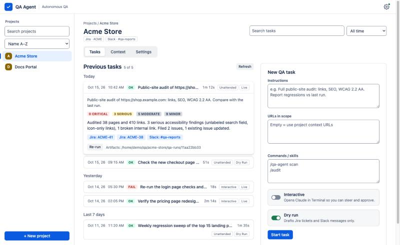

<p align="center">
  
</p>

<h1 align="center">QA Agent</h1>

<p align="center">
  Autonomous QA for websites and web apps, run by <a href="https://claude.com/claude-code">Claude Code</a>,<br>
  with findings filed to <b>Jira</b> and summarised in <b>Slack</b>.
</p>

<p align="center">
  
</p>

## What it is

A small local app. You create a **project** (a site or product, with its Jira project and Slack channel), then start **QA tasks** with plain-language instructions. Claude Code does the work, and the results come back to the app, to Jira, and to Slack. Everything runs on your computer; Jira and Slack are the only shared outputs.

## What it can do

| | |
|---|---|
| **Site audits** | Crawls a site and checks broken links, SEO (titles, descriptions, canonical, Open Graph, structured data, sitemap), accessibility against WCAG (labels, alt text, link and button names, headings, landmarks, zoom), mixed content, and security headers. |
| **App and feature checks** | Tests a new build or feature from a short spec: acceptance checks, happy and error paths, keyboard use, narrow viewports. Playbooks also cover logged-in flows, API and bulk-upload checks, AI output quality against a golden set, and billing in test mode. |
| **Jira and Slack reporting** | Files one ticket per problem group, never duplicates (it searches by a fingerprint label first and comments "seen again"), reopens regressions, and posts one Slack summary per run. |
| **Two ways to run** | **Unattended** (background, live log) or **interactive** (opens Claude in a terminal so you can steer and approve), chosen per task. |
| **Dry run first** | Dry runs only draft the tickets and messages. Switch to live when you trust the result. |
| **History** | Every task with date, status, severity counts, the agent's summary, run time, and links to its Jira issues and Slack messages. Search it and filter by date. |
| **Connection health** | A gear icon with a status light turns red when Claude, Jira or Slack is disconnected. One click shows what is wrong and how to reconnect or disconnect. A welcome screen sets everything up on first run. |
| **Works on any OS** | macOS, Windows and Linux, with an optional launcher icon (Dock, tray, or app menu). |

Things you can ask it, for example:

- *"Full public-site audit of https://example.com: links, SEO, WCAG 2.2 AA. Report regressions against the last run."*
- *"Check release 2.4: the new pricing page and the checkout flow. Dry run."*
- *"Smoke check of the login page and the top 10 landing pages; alert #qa-alerts on anything critical."*

## How it works

```
 You ──▶ QA Agent UI (localhost) ──▶ claude (your Claude Code) ──▶ skill/qa-agent
                                          │                           ├─ scripts: crawl, links, SEO, a11y
                                          ├─ Jira connector ───────▶ Jira issues (de-duplicated)
                                          └─ Slack connector ──────▶ Slack summary
```

The brain is the **qa-agent skill** in [`skill/qa-agent`](skill/qa-agent): a workflow (plan, collect, verify, triage, report), severity rules, playbooks, JSON schemas, and zero-dependency scripts. The UI adds projects, settings, history, and the connection checks.

## Install

You need three things on any OS:

1. **Node.js 18 or newer** (no `npm install` is needed; the app has no dependencies)
2. **Git**
3. **Claude Code** (the `claude` command), installed from [claude.com/claude-code](https://claude.com/claude-code)

### macOS

```bash
brew install node git            # or install Node from https://nodejs.org
git clone https://github.com/EdiBianco/qa-agent.git
cd qa-agent
node bin/qa-agent.js install     # adds "QA Agent" to /Applications (Dock icon)
open /Applications/"QA Agent.app"
```
The app goes into `/Applications` (all users; this needs an administrator account, otherwise it falls back to `~/Applications`), and an older copy in the other location is removed. Quit with Dock icon → right-click → *Quit* (or Cmd-Q); that stops the server.

### Windows (PowerShell)

```powershell
winget install OpenJS.NodeJS.LTS Git.Git     # or install from nodejs.org and git-scm.com
git clone https://github.com/EdiBianco/qa-agent.git
cd qa-agent
node bin\qa-agent.js install                 # Desktop + Start menu shortcuts with the icon
```
Open **QA Agent** from the Desktop or Start menu; right-click → *Pin to taskbar* for the bottom bar. Quit from the tray icon (notification area) to stop the server.

### Linux

```bash
# Node 18+ from https://nodejs.org, nvm, or your package manager; plus git
git clone https://github.com/EdiBianco/qa-agent.git
cd qa-agent
node bin/qa-agent.js install     # adds "QA Agent" to your app menu (and ~/Desktop if present)
```
Launch **QA Agent** from the app menu. With `yad` installed you get a tray icon, otherwise (with `zenity`) a small window: closing it, or *Quit* in the tray, stops the server. With neither, it runs in a terminal (Ctrl+C stops it).

### Any OS, no launcher

```bash
node server.js                         # then open http://localhost:4747
node bin/qa-agent.js serve --open      # same, and opens your default browser
```

**What the launcher does, on every OS:** opening it starts the server and your default browser; closing it (Quit from the Dock or tray, closing the window, or ending the process) stops the server. This holds even if the server was already running when you opened the launcher, and even if the launcher is force-quit or crashes (the server notices within a couple of seconds and shuts down). Tasks that are still running when the server stops keep going in the background and are picked up again the next time it starts.

Related commands: `node bin/qa-agent.js stop` stops whatever server is on the port.

The launcher points at the folder you cloned into, so keep it there (re-run `install` after pulling updates, since the macOS app keeps its own copy of `dock.js`). To remove it: `node bin/qa-agent.js uninstall`.

## First run

On first launch a **welcome screen** checks and helps you set up, in order:

1. **Claude Code**: installed and signed in. If not, *Sign in* opens a terminal running `claude auth login`.
2. **Atlassian (Jira)** and 3. **Slack**: connectors on your Claude account. *Connect* opens your Claude connector settings; approve the sign-in screens. Unattended tasks run headless and cannot do this themselves, so do it once here.
4. **Your first project**: name, workspace folder, Jira project key and board link, Slack channel, and context (URLs, notes, documents).

You also need access to the Jira project and, for private channels, an invite to the Slack channel. Tasks act with *your* permissions. The app has no login of its own: nothing is shared between colleagues except what lands in Jira and Slack, and each person creates their projects once.

### The gear icon

Top right. Green dot: Claude, Jira and Slack are all connected. **Red dot**: one needs attention. Click it to see which, then *Sign in* / *Reconnect* and press *Re-check*. Connected items offer *Sign out* (Claude Code) or *Disconnect* (opens the connector settings where you can disconnect Jira or Slack). *Setup guide* reopens the welcome screen.

## Updating

QA Agent checks GitHub for a newer release when it starts and every 6 hours (no login needed, the repo is public). When there is one, an **Update to vX.Y.Z** pill appears in the top bar; the gear panel also shows the installed version with a *Check for updates* link.

Click the pill to see the release notes, then:

- **Update now**: fetches that release and fast-forwards your checkout to it, then restarts the server and reloads the page by itself (when it was started by a launcher or `qa-agent serve`; if you started it with plain `node server.js`, restart it yourself). Your projects and history are kept. It refuses when the install folder has local changes or tasks are running, and says why.
- **Install updates automatically**: a switch in the same dialog. When on, new releases are applied as soon as they are found and no task is running. It downloads and runs new code from this repository, so leave it off unless you trust the source.
- **A command for your system**: the dialog always shows it, with a *Copy* button.

From a terminal: `node bin/qa-agent.js update` (or `update --check` to only look).

| | Command (replace `<tag>` with the release, e.g. `v0.2.0`; the dialog fills it in) |
|---|---|
| macOS / Linux | `cd "<install folder>" && git fetch --tags --force && git merge --ff-only <tag>` |
| Windows (PowerShell) | `cd "<install folder>"; git fetch --tags --force; git merge --ff-only <tag>` |
| No git, macOS / Linux | `cd "<install folder>" && curl -fsSL https://github.com/EdiBianco/qa-agent/archive/refs/tags/<tag>.tar.gz \| tar -xz --strip-components=1` |
| No git, Windows | `cd "<install folder>"; curl.exe -fsSL -o qa-agent-update.tgz https://github.com/EdiBianco/qa-agent/archive/refs/tags/<tag>.tar.gz; tar -xzf qa-agent-update.tgz --strip-components=1; Remove-Item qa-agent-update.tgz` |

Then restart QA Agent. Notes:
- If an update changes the launcher, the dialog says so; run `node bin/qa-agent.js install` once more to refresh the app icon launcher. The installed Claude skill (`install-skill`) is refreshed automatically.
- Versions before 0.1.7 do not have this feature: update them once by hand with the command above (or `git pull`).
- Running your own fork? Point `repository` in `package.json` at it, and updates will come from your releases.

## Using it

1. Pick a project, or create one (*+ New project*).
2. Write the instructions, optionally list URLs and commands, choose **Interactive/Unattended** and **Dry run/Live**, and press *Start task*.
3. Watch the log, then open the task in the history for the summary, severity counts, and the Jira and Slack links.

Start with a dry run, then a live task against a test Jira project and a test Slack channel before pointing it at real boards.

### Good to know
- The default **Allowed tools** assume the claude.ai connectors (`mcp__claude_ai_Atlassian_MCP`, `mcp__claude_ai_Slack`). If you use other MCP servers, edit that list in the project's Settings.
- Each task uses your own Claude usage, roughly $0.2–0.5 for a short unattended run with the default model (you can change the model per project).
- The unattended agent can run anything in the project's allowed-tools list inside the workspace folder. Keep credentials out of workspace folders.
- The audit script reads static HTML. JavaScript-rendered pages (single-page apps) are flagged `client-rendered` and need a browser to test properly.

## The skill on its own

`skill/qa-agent` is a regular Claude Code skill. Install it for any Claude Code session (not only the UI):

```bash
node bin/qa-agent.js install-skill       # copies it to ~/.claude/skills/qa-agent
node bin/qa-agent.js uninstall-skill
```

Run the audit by hand:

```bash
node skill/qa-agent/scripts/site-audit.js https://example.com --out ./audit --max 40
```

It writes `findings.json`, `crawl.json`, and `summary.md`.

## Configuration

| | |
|---|---|
| `PORT=5000` | change the port (default 4747) |
| `QA_AGENT_DATA=/some/folder` | where projects, task history, and uploaded documents are stored (default `./data`) |
| `data/server.log` | server log when started through a launcher |
| `QA_AGENT_API=<url>` | GitHub API base used for update checks (GitHub Enterprise, tests) |
| `node scripts/make-icons.js` | regenerate the icons in `assets/` |

## Troubleshooting

| Problem | Fix |
|---|---|
| Red dot, "The claude command was not found" | Install Claude Code, open a new terminal, press *Re-check*. |
| Red dot, "Not signed in" | *Sign in* in the gear panel (or run `claude auth login`), then *Re-check*. |
| Jira or Slack "Needs authentication" | *Reconnect* opens your Claude connector settings. Approve, then *Re-check*. |
| Tasks run but nothing reaches Jira or Slack | You are on **Dry run**, or the connector is disconnected, or you lack access to the project or channel. |
| "Can't update in place" | The install folder has local changes or was not installed with git. Use the command shown in the update dialog. |
| Port already in use | Another copy is running (a launcher just opens the browser then). Use `PORT=5001 node server.js`. |
| Windows shortcut does nothing | Your organisation may block PowerShell scripts; run `node server.js` instead. |

## Notes

- The server listens on `127.0.0.1` only and rejects cross-origin requests, because it can start processes on your machine.
- **Tested on macOS.** The Windows and Linux launchers and terminal launching follow each platform's documented behavior but have not been run on those systems; please report anything that misbehaves.
